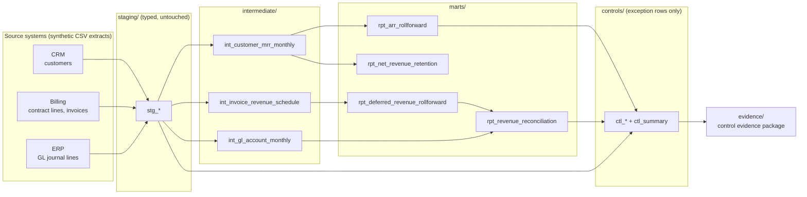

# SaaS Finance Warehouse

A working finance data warehouse for a B2B SaaS company. It covers the subscription metrics leadership runs the business on (ARR bridge, NRR/GRR), the revenue and deferred-revenue numbers that go into the financial statements, and **SOX-style controls that run as code** and produce audit-ready evidence on every build.

The company, Halyard Software, Inc., is fictional and all data is synthetic: ~330 customers, ~2,200 invoices and 36 months of general ledger. By default the generator also plants six realistic errors (a duplicate invoice, an unsupported top-side revenue entry, a self-approved journal entry, and so on). The point is to show the controls catching them.

```
python run_pipeline.py
```

```
  REV-01  EXCEPTION    1  Revenue subledger-to-GL reconciliation
  REV-02  PASS         0  Deferred revenue subledger-to-GL reconciliation
  BIL-01  EXCEPTION    1  Duplicate billing detection
  BIL-02  EXCEPTION    1  Invoice-to-contract price accuracy
  DQ-01   EXCEPTION    1  Invoice master-data integrity
  GL-01   EXCEPTION    1  Journal entries balance
  GL-02   EXCEPTION    1  Manual journal entry segregation of duties
  ARR-01  PASS         0  ARR roll-forward integrity
```

Sample outputs: [`evidence/control_evidence.md`](evidence/control_evidence.md) · [`evidence/metrics_snapshot.md`](evidence/metrics_snapshot.md)

---

## The problem this models

At a scaling SaaS company, Finance gets the same question from three directions:

- **The board asks** what ARR is, how it moved, and whether customers are expanding or leaving.
- **The auditors ask** whether revenue in the ledger is supported by what was actually billed and delivered.
- **The CFO asks** why those two numbers don't match.

Those answers usually live in separate spreadsheets owned by separate people. This warehouse puts them on one set of tested models: one contract-level source of truth feeds both the metrics and the accounting, and the controls show where they diverge and why.

## Architecture



| Layer | What lives there | Materialization |
|---|---|---|
| `staging/` | Raw extracts typed and renamed. Never edited, never filtered. | view |
| `intermediate/` | Reusable building blocks: densified customer-month MRR, ratable revenue schedule, GL activity and balances | table |
| `marts/` | What people consume: ARR bridge, retention, revenue, deferred revenue, reconciliation workpaper | table |
| `controls/` | One model per control, returning **only exception rows** | table |

Stack: dbt + DuckDB. Everything runs locally in about 10 seconds with no accounts or cloud setup. The SQL is portable to Snowflake or BigQuery with minor dialect changes.

## Controls

The full matrix, with risk, objective, assertion, frequency and owner for each control, is in [`controls/control_matrix.yml`](controls/control_matrix.yml).

| ID | Control | Planted error it catches |
|---|---|---|
| REV-01 | Revenue subledger ties to GL 4000 monthly | A $25K "Q2 revenue true-up per sales leadership" manual entry. **It was properly approved, so GL-02 passes it.** Only the reconciliation catches it: approval is not support. |
| REV-02 | Deferred revenue subledger ties to GL 2400 | Nothing planted. It passes, as it should. |
| BIL-01 | No contract term billed twice | A re-run invoice batch that bills a $76.8K annual term a second time |
| BIL-02 | Invoice equals contracted price × months | An annual invoice billed $2,400 above contract |
| DQ-01 | Every invoice maps to a real customer and contract | An invoice for a customer that isn't in the CRM |
| GL-01 | Every journal entry balances | A manual accrual with a transposition error (12,400 vs 12,040) |
| GL-02 | Manual entries approved by someone other than the preparer | An entry prepared and approved by the same person |
| ARR-01 | The ARR bridge foots and rolls month to month | Nothing planted. It's a guardrail on the metrics logic itself. |

Design choices behind the controls:

- **Controls are models, not just tests.** Each one returns its exception rows as a table, so the exceptions can be queried, exported and tracked. A dbt test on each control raises a *warning* rather than failing the build, because a control finding something is the control working. Data-integrity tests (keys, accepted values, schedules summing to invoices) are *errors* and do stop the build.
- **Full population, not samples.** Every invoice, journal line and month is tested on every run.
- **The controls are tested too.** `pytest` runs the pipeline twice. On seeded data, every planted error must be caught by its control and nothing else may be flagged. On clean data, every control must pass. In audit terms, that's a test of design with known exceptions, automated.
- **Evidence is generated, not assembled.** Each run writes an evidence package: what was tested, a fingerprint of the exact source files, the result and the exception detail.

## Metric definitions

The ARR, NRR/GRR, revenue and deferred-revenue definitions, including the judgment calls (customer-level netting, reactivation kept separate from new, monthly proration), are written down in [`docs/metric_definitions.md`](docs/metric_definitions.md).

## Run it

Requires Python 3.10+.

```bash
python -m venv .venv
source .venv/bin/activate          # Windows: .venv\Scripts\activate
pip install -r requirements.txt

python run_pipeline.py             # demo: planted errors, controls catch them
python run_pipeline.py --clean     # same company, nothing planted: every control passes
pytest -q                          # control design tests + finance logic tests
```

Explore the warehouse directly:

```bash
python -c "import duckdb; print(duckdb.connect('warehouse.duckdb').sql('select * from rpt_arr_rollforward order by 1 desc limit 6'))"
```

## Taking this to production

What would change with real systems and a team:

- **Ingestion:** managed connectors (Fivetran or similar) from Salesforce, the billing system and NetSuite into Snowflake, replacing the CSV extracts. Staging models stay the same shape.
- **Orchestration and alerting:** scheduled builds tied to the close calendar. Control exceptions route to the owner in Slack or a ticket queue with an SLA, and close sign-off is gated on REV-01 and REV-02 being clear or explained.
- **Change management (ITGC):** the CI workflow here runs on every pull request. In production, branch protection plus required review on `models/controls/` would be the change-management control auditors test.
- **Revenue precision:** daily proration, mid-term amendments, credit memos, multi-currency, and usage-based components.
- **Exception lifecycle:** a persisted exception log with status, root cause and resolution, so evidence shows not just what was found but how it was closed.

---

Built by Charles Primbas. Synthetic data only; no real company or customer data is used.
