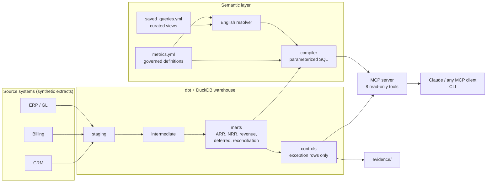

# SaaS Finance Warehouse

[](https://github.com/cprimbas-mpinc/saas-finance-warehouse/actions/workflows/ci.yml)   

A working finance data platform for a B2B SaaS company, in three layers:

1. **A warehouse** (dbt + DuckDB) with the subscription metrics leadership runs the business on (ARR bridge, NRR/GRR) and the revenue and deferred-revenue numbers that go into the financial statements.
2. **SOX-style controls that run as code** on every build and produce audit-ready evidence.
3. **A governed semantic layer behind an MCP server**, so anyone (or any AI assistant) can ask finance questions in plain English and get the *certified* answer, along with its definition and the exact SQL behind it.

The company, Halyard Software, Inc., is fictional and all data is synthetic: ~330 customers, ~2,200 invoices and 36 months of general ledger. The generator plants six realistic accounting errors so the controls have something to catch.

```
$ python -m finance_semantic ask "NRR and GRR by segment"

Understood as: nrr, grr, by segment, monthly from 2025-12 to 2025-12
  matched: metric nrr ('nrr'); metric grr ('grr'); group by segment

period   segment     Net revenue retention  Gross revenue retention
-------  ----------  ---------------------  -----------------------
2025-12  Enterprise                 103.3%                    98.1%
2025-12  Mid-Market                 101.6%                    93.1%
2025-12         SMB                  90.5%                    84.2%
```

```
$ python run_pipeline.py
  REV-01  EXCEPTION    1  Revenue subledger-to-GL reconciliation
  REV-02  PASS         0  Deferred revenue subledger-to-GL reconciliation
  BIL-01  EXCEPTION    1  Duplicate billing detection
  BIL-02  EXCEPTION    1  Invoice-to-contract price accuracy
  DQ-01   EXCEPTION    1  Invoice master-data integrity
  GL-01   EXCEPTION    1  Journal entries balance
  GL-02   EXCEPTION    1  Manual journal entry segregation of duties
  ARR-01  PASS         0  ARR roll-forward integrity
```

Sample outputs: [`evidence/control_evidence.md`](evidence/control_evidence.md) · [`evidence/metrics_snapshot.md`](evidence/metrics_snapshot.md)

---

## The problem this models

At a scaling SaaS company, Finance gets the same question from three directions:

- **The board asks** what ARR is, how it moved, and whether customers are expanding or leaving.
- **The auditors ask** whether revenue in the ledger is supported by what was actually billed and delivered.
- **The CFO asks** why those two numbers don't match.

Then everyone else asks for "just a quick number" in Slack. Those answers usually live in separate spreadsheets and ad-hoc queries, each with its own definition of ARR.

This project puts them on one set of tested models. A single contract-level source of truth feeds both the metrics and the accounting. The controls show where the two diverge and why. The semantic layer means a self-serve question gets the same answer the board deck does.

## Architecture



| Layer | What lives there |
|---|---|
| `models/staging/` | Raw extracts typed and renamed. Never edited, never filtered. |
| `models/intermediate/` | Building blocks: densified customer-month MRR, ratable revenue schedule, GL activity and balances |
| `models/marts/` | What people consume: ARR bridge, retention, revenue, billings, deferred revenue, reconciliation |
| `models/controls/` | One model per control, returning **only exception rows** |
| `semantic_layer/` | Metric definitions and curated saved queries (YAML) |
| `finance_semantic/` | Compiler, English resolver, service API, MCP server and CLI (Python) |

## The semantic layer and MCP server

### Why a semantic layer, not text-to-SQL

An LLM writing SQL against raw tables will eventually invent its own definition of ARR. Typical mistakes are summing a balance across a quarter (3× too big), averaging ratios, or double-counting through a join. In finance, a plausible wrong number is worse than no number.

So the language understanding and the math are kept apart:

- **Definitions live in one reviewed file** ([`semantic_layer/metrics.yml`](semantic_layer/metrics.yml)). Each of the 19 metrics has a description, owner, certification flag and synonyms.
- **Time roll-ups are explicit per measure.** Flows like new ARR and revenue *sum* across months. Balances like ARR, customers and deferred revenue take the *period-end* value. Beginning ARR takes the *period-start* value. Ratios like NRR are computed from rolled-up numerators and denominators, never averaged.
- **The compiler only emits names from the catalog.** Every user-supplied value (dates, filter values) is a bound parameter, so nothing typed by a person or a model reaches the SQL text.
- **Every answer carries its audit trail:** how the question was understood, which words were ignored, the definitions used, the exact SQL with parameters, and the data's freshness.
- **The warehouse connection is sandboxed:** read-only, with file and network access disabled and locked.

### MCP tools

| Tool | What it does |
|---|---|
| `ask` | Plain-English question → interpretation + governed answer + SQL |
| `list_metrics` / `describe_metric` | The metric catalog: definitions, formulas, owners, allowed dimensions |
| `query_metrics` | Structured query: metrics × dimensions × grain × time window × filters |
| `list_saved_queries` / `run_saved_query` | Curated views: ARR bridge, board KPIs, retention by segment, revenue tie-out... |
| `get_control_status` | Control results, exception detail and the exception log (owner, status, aging) |
| `forecast_arr` | Driver-based ARR bridge forecast with its backtest record and range (labeled uncertified) |
| `run_sql` | Escape hatch: one sandboxed SELECT, labeled uncertified |

When Claude is the client, it handles the open-ended language and calls `query_metrics` directly. The built-in `ask` resolver also works on its own with any client. It's deterministic on purpose: the same question always maps to the same definitions, and it reports exactly how it read the question.

### Things you can ask

```
python -m finance_semantic ask "what is our ARR?"
python -m finance_semantic ask "ARR by segment last 6 months"
python -m finance_semantic ask "quarterly net new ARR in 2025"
python -m finance_semantic ask "net revenue retention for EMEA last 4 quarters"
python -m finance_semantic ask "which industry has the most churned ARR in 2025"
python -m finance_semantic ask "show me the ARR bridge"
python -m finance_semantic ask "board KPIs"
python -m finance_semantic ask "does revenue tie to the GL?" --sql
python -m finance_semantic ask "any control exceptions?"
```

### Forecasting

`python -m finance_semantic forecast` projects the ARR bridge (new, expansion, contraction, churn) up to 12 months from the governed history, and shows its own track record: a rolling-origin backtest against a straight-line trend at every horizon. On the demo data it beats the trend by a small margin out to about 5 months, ties at 6, and runs low because new ARR has been rising. The range comes from the backtest's own errors. Method, results and limits: [`docs/forecasting.md`](docs/forecasting.md).

```
Month       ARR forecast            Low           High
2026-01      $13,851,055    $13,535,774    $14,399,733
2026-03      $14,993,029    $14,460,221    $16,160,111
2026-06      $16,707,654    $16,581,016    $18,494,765
```

### Governance checks

`python -m finance_semantic lint` reviews the catalog the way a metrics owner would before a definition ships, and CI fails the build on any finding:

- every metric has an owner, a real description and synonyms
- no phrase points at two different metrics, since ambiguity there means two people get two numbers
- balances and ratios never sum across months
- every metric's own name, asked as a question, resolves back to that metric, and every saved-query phrase reaches its saved query

### Connect it to Claude

Build the warehouse once (`python run_pipeline.py`). Then add the server to Claude Desktop's config file (Settings → Developer → Edit Config), using the full path to your clone:

```json
{
  "mcpServers": {
    "saas-finance-warehouse": {
      "command": "python",
      "args": ["/full/path/to/saas-finance-warehouse/mcp_server.py"]
    }
  }
}
```

On Windows, use a path like `"C:\\Users\\you\\saas-finance-warehouse\\mcp_server.py"`. If you use a virtual environment, point `command` at that environment's Python. With Claude Code, run `claude mcp add saas-finance-warehouse -- python /full/path/to/mcp_server.py`.

## Controls

The full matrix, with risk, objective, assertion, frequency and owner, is in [`controls/control_matrix.yml`](controls/control_matrix.yml).

| ID | Control | Planted error it catches |
|---|---|---|
| REV-01 | Revenue subledger ties to GL 4000 monthly | A $25K "Q2 revenue true-up per sales leadership" manual entry. **It was properly approved, so GL-02 passes it.** Only the reconciliation catches it: approval is not support. |
| REV-02 | Deferred revenue subledger ties to GL 2400 | Nothing planted. It passes, as it should. |
| BIL-01 | No contract term billed twice | A re-run invoice batch that bills a $76.8K annual term a second time |
| BIL-02 | Invoice equals contracted price × months | An annual invoice billed $2,400 above contract |
| DQ-01 | Every invoice maps to a real customer and contract | An invoice for a customer that isn't in the CRM |
| GL-01 | Every journal entry balances | A manual accrual with a transposition error (12,400 vs 12,040) |
| GL-02 | Manual entries approved by someone other than the preparer | An entry prepared and approved by the same person |
| ARR-01 | The ARR bridge foots and rolls month to month | Nothing planted. It's a guardrail on the metrics logic itself. |

Design choices behind the controls:

- **Controls are models, not just tests.** Each returns its exception rows as a table that can be queried, exported and tracked, including through the MCP server. A control finding something raises a *warning* rather than failing the build, because that's the control working. Data-integrity tests (keys, accepted values, schedules summing to invoices) are *errors* and do stop the build.
- **Full population, not samples.** Every invoice, journal line and month is tested on every run.
- **The controls are tested too.** On seeded data, every planted error must be caught by its control and nothing else may be flagged. On clean data, every control must pass. In audit terms, that's an automated test of design.
- **Exceptions are tracked to resolution.** `rpt_control_exception_log` joins each finding to an owner, root cause, action and due date (a seed file stands in for a ticketing system). It flags anything unassigned or overdue, and marks an item *cleared* once the controls stop finding it. In the demo, the unsupported $25K revenue entry is still under investigation and overdue, and the orphan invoice hasn't been triaged.
- **Evidence is generated, not assembled.** Each run writes an evidence package: what was tested, a fingerprint of the exact source files, the result and the exception detail.

## Metric definitions

The judgment calls are written down in [`docs/metric_definitions.md`](docs/metric_definitions.md): customer-level netting, reactivation kept separate from new, cohort NRR/GRR, and monthly proration.

## Run it

Requires Python 3.10+.

```bash
git clone https://github.com/cprimbas-mpinc/saas-finance-warehouse.git
cd saas-finance-warehouse
python -m venv .venv
source .venv/bin/activate          # Windows: .venv\Scripts\activate
pip install -r requirements.txt     # add -dev for the linter

python run_pipeline.py             # build: planted errors, controls catch them
python run_pipeline.py --clean     # same company, nothing planted: every control passes
python -m finance_semantic ask "ARR by segment last 6 months"
python -m finance_semantic forecast 6
pytest -q                          # 61 tests: controls, finance logic, semantic layer, forecast, MCP server
```

## Tests

| Suite | What it proves |
|---|---|
| `tests/test_pipeline.py` | Each planted error is caught by exactly its control; clean data passes everything; the ARR and deferred revenue bridges foot; every billed dollar is recognized; the generator is deterministic |
| `tests/test_semantic_layer.py` | Semantic answers match the warehouse's own reports; quarter roll-ups use period-end balances and summed flows; segments sum to totals; filter values can't inject SQL; `run_sql` allows one sandboxed SELECT and nothing else; common English phrasings resolve to the right metrics, dimensions and time windows |
| `tests/test_governance.py` | The catalog linter passes on the real catalog and catches each kind of bad definition |
| `tests/test_forecast.py` | The forecast bridge foots and chains from the last actual month; the range contains the forecast; the backtest scores every horizon; on synthetic data with stable drivers the model is exact and the trend isn't |
| `tests/test_mcp_server.py` | A real MCP client lists 9 read-only tools and gets correct answers and clean error messages |

## Roadmap

This is a living project; see [`CHANGELOG.md`](CHANGELOG.md).

- **Next:** explain-change (decompose a metric's movement into drivers and segments, as grounded input for variance commentary); daily revenue proration, mid-term amendments and credit memos; a metrics-change review workflow (who changed a definition, when, and why).
- **Then:** Snowflake target alongside DuckDB; scheduled builds on a close calendar; exception routing to owners; usage-based billing and multi-currency.
- **AI:** variance commentary drafted from the semantic layer and reviewed by a person; anomaly triage on control exceptions.

## Taking this to production

- **Ingestion:** managed connectors (Fivetran or similar) from Salesforce, the billing system and NetSuite into Snowflake, replacing the CSV extracts. Staging keeps the same shape.
- **Orchestration and alerting:** builds tied to the close calendar; control exceptions routed to owners with an SLA; close sign-off gated on REV-01 and REV-02 being clear or explained.
- **Change management (ITGC):** CI runs on every pull request. Branch protection plus required review on `models/controls/` and `semantic_layer/` would be the change-management controls auditors test.
- **Access:** the MCP server runs behind SSO with role-based access to sensitive metrics, and every query is logged.

---

Built by Charles Primbas. Synthetic data only; no real company or customer data is used.
